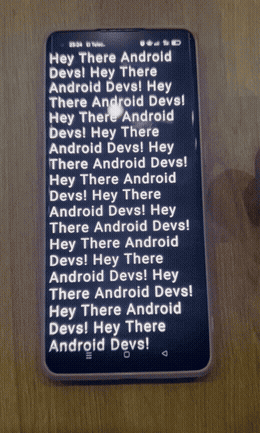

<h1 align="center">Android AGSL Shader Playground 🎨</h1>

<p align="center">
  A Jetpack Compose library and showcase of <b>AGSL runtime-shader animations</b> —<br/>
  ripples, waves, transitions, liquid glass refraction, fluid simulation, and procedural shaders —<br/>
  ready to wrap around any composable.
</p>

<p align="center">
  <a href="https://central.sonatype.com/artifact/io.github.mejdi14/android-shader-effect">
    
  </a>
  
  
  <a href="LICENSE">
    
  </a>
  <a href="https://github.com/mejdi14/Android-AGSL-Shader-Playground/stargazers">
    
  </a>
</p>

## ✨ Demo

<div align="center">
  
  &nbsp;&nbsp;
  
  &nbsp;&nbsp;
  
</div>

## 📑 Table of Contents

- [Effects Overview](#-effects-overview)
- [Requirements](#️-requirements)
- [Installation](#-installation)
- [Usage](#-usage)
  - [Ripples & Waves](#ripples--waves)
  - [Transitions](#transitions)
  - [Distortion & Motion](#distortion--motion)
  - [Refraction & Liquid Glass](#refraction--liquid-glass)
  - [Generative, Materials & Glitch](#generative-materials--glitch)
- [Demo App Showcases](#-demo-app-showcases)
- [Custom AGSL Shaders](#️-custom-agsl-shaders)
- [API Reference](#-api-reference)
- [Project Structure](#-project-structure)
- [Contributing](#-contributing)
- [Acknowledgements](#-acknowledgements)
- [License](#-license)

## 🧩 Effects Overview

### Library Effects (`shaderRippleEffect`)

| Category | Composable | Trigger | Description |
|----------|------------|---------|-------------|
| **Ripples & Waves** | [`ShaderRippleEffect`](#shaderrippleeffect) | Tap | Expanding ripple radiating from the touch point |
| | [`ComplexWaveEffect`](#complexwaveeffect) | Continuous | Flowing multi-wave distortion for living backgrounds or text |
| | [`DongxiaoWaveEffect`](#dongxiaowaveeffect) | Press / Drag | Interactive dual-wave ripple and glow following the pointer |
| **Transitions** | [`RevealShaderEffect`](#revealshadereffect) | Tap | Crossfades two composables behind a wiggling ripple mask |
| | [`RippleTransitionEffect`](#rippletransitioneffect) | Tap | Noisy ripple wavefront with colour split between `ImageBitmap`s |
| | [`NoiseDissolveEffect`](#noisedissolveeffect) | Tap | Fractal noise burn-away dissolve transition |
| **Distortion & Motion** | [`MotionBlurEffect`](#motionblureffect) | Drag | Directional blur trailing the finger and easing out on release |
| | [`VortexEffect`](#vortexeffect) | Continuous / Tap | Twisting spiral distortion — tap to re-center |
| | [`FluidDisplacementEffect`](#fluiddisplacementeffect) | Drag | 2D Navier-Stokes fluid simulation warping wrapped content |
| **Refraction & Glass** | [`LiquidGlass`](#liquidglass--draggableliquidglassdemo) | Dynamic / Drag | Frosted glass with bevel refraction, dispersion, and specular rim |
| | [`GuideLiquidGlass`](#guideliquidglass) | Dynamic / Drag | Quarter-circle lens refraction with optional 7-band dispersion |
| | [`LiquidGlassRingEffect`](#liquidglassringeffect) | Tap | Expanding borderless ring of liquid-glass refraction |
| **Generative & Patterns** | [`KoiPondEffect`](#koipondeffect) | Continuous / Tap / Drag | Procedural koi pond with spline fish, fBm patterns, caustics, and fluid eddies |
| | [`MetaballsEffect`](#metaballseffect) | Continuous | Gooey drifting and merging blobs rendered via `ShaderBrush` |
| | [`KaleidoscopeEffect`](#kaleidoscopeeffect) | Continuous | Rotating mirrored mandala wedges |
| **Materials & Glitch** | [`HolographicStickerEffect`](#holographicstickereffect) | Tilt / Drag | Foil card sheen, diamond texture, and glitter inside light sweeps |
| | [`CrtGlitchEffect`](#crtglitcheffect) | Continuous / Press / Drag | Retro CRT barrel curvature, scanlines, noise, and RGB glitch |
| | [`PixelMeltEffect`](#pixelmelteffect) | Drag | Downward pixel-sorting melt with RGB separation |

### Demo App Showcases (`app`)

In addition to demos for every library effect above, the sample app includes three standalone visual showcases: **Particles**, **Paper Fold**, and **Curved 3D Gallery** (see [Demo App Showcases](#-demo-app-showcases)).

## ⚙️ Requirements

| Requirement | Minimum |
|-------------|---------|
| Android SDK | **33+** (Android 13 “Tiramisu”) — AGSL `RuntimeShader` requires API 33 |
| Jetpack Compose | 1.7.0+ |
| Language | Kotlin |

## 📦 Installation

Make sure `mavenCentral()` is enabled in `settings.gradle.kts`:

```kotlin
dependencyResolutionManagement {
    repositories {
        google()
        mavenCentral()
    }
}
```

Add the library dependency to your module’s `build.gradle.kts`:

```kotlin
dependencies {
    implementation("io.github.mejdi14:android-shader-effect:0.1.3")
}
```

## 🔥 Usage

### Ripples & Waves

#### `ShaderRippleEffect`

Wrap any composable; a ripple radiates from wherever the user taps.

```kotlin
ShaderRippleEffect(
    amplitude = 15f,           // height of the ripple waves
    frequency = 20f,           // how many waves appear
    decay = 6f,                // how quickly the ripple fades
    speed = 2000f,             // how fast the ripple propagates
    animationDuration = 3.5f   // duration in seconds
) {
    Image(
        painter = painterResource(id = R.drawable.your_image),
        contentDescription = null,
        modifier = Modifier.fillMaxSize()
    )
}
```

#### `ComplexWaveEffect`

A continuous, flowing wave distortion — great for water, flags, or living backgrounds.

```kotlin
ComplexWaveEffect(
    speed = 0.8f,          // how fast the waves move
    strength = 25f,        // wave amplitude
    frequency = 8f,        // how many waves appear
    timeMultiplier = 1.2f  // how time scales the animation
) {
    Text(
        text = "Wavy Text Effect",
        style = MaterialTheme.typography.displayLarge,
        modifier = Modifier.padding(32.dp)
    )
}
```

#### `DongxiaoWaveEffect`

Interactive hover/press wave that tracks the pointer with a primary ripple, secondary echo, and soft spotlight.

```kotlin
DongxiaoWaveEffect(modifier = Modifier.fillMaxSize()) {
    YourContent()
}
```

---

### Transitions

#### `RevealShaderEffect`

Tap to transition from one composable to another behind an expanding, wiggling ripple front.

<div align="center">
  
</div>

```kotlin
RevealShaderEffect(
    waveParams = WaveEffectParams(
        amplitude = 40f,
        frequency = 20f,
        decay = 5f,
        speed = 1000f,
        duration = 3f
    ),
    revealParams = RevealTransitionParams(
        speed = 1200f,
        frequency = 40f,
        wiggleStrength = 38f,
        edgeWidth = 0f,
        duration = 3f,
        transitionDelay = 200
    ),
    firstContent = { FirstContent() },   // content to hide
    secondContent = { SecondContent() }  // content to reveal
)
```

#### `RippleTransitionEffect`

Tap and a noisy ripple wavefront races out from the touch point, pushing the image, splitting its colour at the crest, and revealing the next photo in its wake. Because it samples two photos at once, they are bound as two child shaders on the `RuntimeShader`.

```kotlin
RippleTransitionEffect(
    images = listOf(
        ImageBitmap.imageResource(R.drawable.photo_a),
        ImageBitmap.imageResource(R.drawable.photo_b)
    ),
    modifier = Modifier.fillMaxSize(),
    waveSpeed = 1.6f,
    pushAmt = 0.145f,
    glow = 0.73f
)
```

#### `NoiseDissolveEffect`

Tap to toggle an organic fractal Brownian motion (fBm) dissolve with a glowing ember edge.

```kotlin
NoiseDissolveEffect(modifier = Modifier.fillMaxSize()) {
    YourContent()
}
```

---

### Distortion & Motion

#### `MotionBlurEffect`

Directional blur that trails the user’s drag and eases out on release. Inspired by [Daniel Kuntz](https://x.com/dankuntz)’ work.

<div align="center">
  
</div>

```kotlin
MotionBlurEffect(
    modifier = Modifier,
    intensity = 2f,        // strength of the blur
    falloffRadius = 390f   // distance over which the blur decays
) {
    YourContent()
}
```

#### `VortexEffect`

A twisting spiral, strongest at the center and fading out by `radius`. Tap to move the center.

```kotlin
VortexEffect(
    strength = 3.5f,  // max twist (radians) at the center
    radius = 700f,    // falloff radius in pixels
    speed = 0.5f      // how fast the spiral churns
) {
    YourContent()
}
```

#### `FluidDisplacementEffect`

Drag across the content to stir a 2D Stable-Fluids Navier-Stokes simulation that warps the image in real time. The swirling eddies carry forward under momentum and continue curling for several seconds after release.

```kotlin
FluidDisplacementEffect(
    modifier = Modifier.fillMaxSize(),
    amount = 0.15f,                           // displacement strength
    channelMode = FluidChannelMode.TwoAxis,   // Red/Green drive horizontal/vertical warp
    edges = FluidEdgeMode.Mirror,             // seamless mirror reflection at borders
    colorMode = FluidColorMode.Rainbow,       // brush hue cycles along the stroke
    curl = 14f,                               // vorticity confinement keeping eddies spinning
    decay = 0.5f,                             // how quickly fluid trails dissipate
    momentum = 0.6f                           // velocity carry-through after release
) {
    Image(
        painter = painterResource(id = R.drawable.your_image),
        contentDescription = null,
        modifier = Modifier.fillMaxSize()
    )
}
```

---

### Refraction & Liquid Glass

#### `LiquidGlass` & `DraggableLiquidGlassDemo`

`LiquidGlass` samples a shared `GlassBackdrop` GPU layer to render a rounded rectangle with a saturated 3px blur, translucent tint, bevel edge refraction with chromatic dispersion, and a specular rim lighting pass. `DraggableLiquidGlassDemo` wraps a full-scene draggable demo.

```kotlin
val backdrop = rememberGlassBackdrop()
Box(Modifier.fillMaxSize()) {
    YourBackground(Modifier.fillMaxSize().glassBackdropSource(backdrop))
    LiquidGlass(
        backdrop = backdrop,
        modifier = Modifier.align(Alignment.Center).size(280.dp, 180.dp)
    ) {
        // Sharp foreground content inside the glass
    }
}

// Or use the pre-built draggable scene:
DraggableLiquidGlassDemo(background = painterResource(R.drawable.your_photo))
```

#### `GuideLiquidGlass`

Adapts the archived Kyant `AndroidLiquidGlass` shaders explained in [How Liquid Glass Is Implemented](https://sitong-zhang.github.io/apple-liquid-glass-guide/docs/09-How-Liquid-Glass-Is-Implemented.html). Used by the gallery's **Apple Liquid Glass** demo on a draggable 280 × 180dp lens with 22dp corners, 1.5× saturation, a 32dp quarter-circle refraction band, 45° directional highlight, and optional seven-band dispersion while dragging.

```kotlin
val backdrop = rememberGlassBackdrop()
Box {
    YourBackground(Modifier.glassBackdropSource(backdrop))
    GuideLiquidGlass(backdrop, Modifier.size(280.dp, 180.dp))
}
```

The adapted shader source retains Kyant's copyright and Apache 2.0 notice; see [the upstream license](docs/licenses/AndroidLiquidGlass-APACHE-2.0.txt).

#### `LiquidGlassRingEffect`

Tap to send a borderless ring of liquid-glass refraction expanding across the content. Distortion fades smoothly to zero at both edges of the band.

```kotlin
LiquidGlassRingEffect(
    modifier = Modifier.fillMaxSize(),
    bandWidth = 180.dp,     // thickness of the glass ring
    refraction = 1f,        // 1 = matches LiquidGlass's refraction strength
    fromTapPoint = false    // true = start where you tap
) {
    YourPhoto()
}
```

---

### Generative, Materials & Glitch

#### `KoiPondEffect`

A self-contained procedural koi pond combining Catmull-Rom spine triangulation (`Canvas.drawVertices`), boids steering, AGSL Value Noise / fBm shaders for koi scale patterns, underwater shadows, and gesture-driven `FluidDisplacementEffect` distortion (`seedInitialImpulse = false`). Tap to feed the koi; drag to stir fluid eddies across the pond.

```kotlin
KoiPondEffect(
    modifier = Modifier.fillMaxSize(),
    fishCount = 7,                             // number of koi in the pond (1..16)
    swimSpeed = 1f,                            // swimming speed multiplier
    waterColorDeep = Color(0xFF5BB5DA),        // deep-water base tint
    waterColorShallow = Color(0xFF8BD3F0),     // shallow-water and caustic tint
    showLilypads = true,                       // render floating lilypads and lotus blossoms
    displacementAmount = 0.15f                 // gesture fluid displacement strength
)
```

#### `MetaballsEffect`

Coloured gooey balls drifting around the centre and merging into smooth organic shapes. Because it is generative rather than filtering child content, it renders directly through a `ShaderBrush`.

```kotlin
MetaballsEffect(
    modifier = Modifier.fillMaxSize(),
    count = 10f,        // 1..20 balls; fractions shrink the last one
    size = 0.83f,       // ball size, 0..1
    speed = 1f,         // animation speed
    colors = DefaultMetaballColors
)
```

#### `KaleidoscopeEffect`

Mirrors your content into radial wedges that form a slowly rotating mandala.

```kotlin
KaleidoscopeEffect(
    segments = 6f,        // number of mirrored wedges
    rotationSpeed = 0.3f  // radians per second
) {
    YourContent()
}
```

#### `HolographicStickerEffect`

A glossy foil card that catches the light as you tilt or drag it. Rather than tinting the artwork, it keeps the card's own colours and lights it with a diagonal sheen sweep containing diamond/square foil texture and glitter inside the sweep.

```kotlin
HolographicStickerEffect(
    modifier = Modifier.width(240.dp).aspectRatio(580f / 810f),
    motion = StickerMotion.Tilt,   // or StickerMotion.Drag
    sheenWidth = 0.26f,            // how broad the light sweep is
    sheenIntensity = 0.45f,        // how bright it is
    foilTexture = 0.2f,            // diamond texture inside the sweep
    sparkle = 0.3f                 // glitter inside the sweep
) {
    Image(
        painter = painterResource(id = R.drawable.your_card),
        contentDescription = null,
        modifier = Modifier.fillMaxSize()
    )
}
```

#### `CrtGlitchEffect`

Retro CRT monitor simulation with barrel curvature, scanlines, vignette, and noise; pressing or dragging intensifies horizontal glitch bands and RGB chromatic aberration.

```kotlin
CrtGlitchEffect(modifier = Modifier.fillMaxSize()) {
    YourContent()
}
```

#### `PixelMeltEffect`

Drag across the content to trigger a downward blocky pixel-sorting melt with RGB channel separation along the melt boundaries.

```kotlin
PixelMeltEffect(modifier = Modifier.fillMaxSize()) {
    YourContent()
}
```

## 📱 Demo App Showcases

The `app/` module includes an interactive gallery of 20 demos driven by `DemoCatalog.kt`. Alongside demos for every library composable, it features three app-level showcases:

- **Particles** (`app/.../particles/ParticleField.kt`) — Interactive dot field that parts around your finger and reshapes on tap.
- **Paper Fold** (`app/.../paperfold/PaperFoldShowcaseScreen.kt`) — Multi-chapter showcase with diagonal cloth folding and halftone morphing.
- **Curved 3D Gallery** (`app/.../gallery/`) — Landscape subdivided-mesh 3D image ribbon powered by OpenGL ES vertex + fragment shaders (since AGSL is fragment-only and does not support 3D vertex mesh deformation).

## 🎛️ Custom AGSL Shaders

Most distortion, wave, and generative effects accept a custom AGSL shader string parameter (such as `rippleShaderCode`, `waveShaderCode`, `kaleidoscopeShaderCode`, `vortexShaderCode`, `foilShaderCode`, `metaballsShaderCode`, `ringShaderCode`, `fluidShaderCode`, `waterShaderCode`, or `koiShaderCode`) so you can override the built-in shader completely:

```kotlin
ShaderRippleEffect(
    rippleShaderCode = """
        uniform shader inputShader;
        uniform float2 uOrigin;
        uniform float uTime;
        // ...your custom AGSL here...
        half4 main(float2 fragCoord) {
            return inputShader.eval(fragCoord);
        }
    """.trimIndent(),
) {
    // Your content
}
```

## 👨‍💻 API Reference

Click any composable below to expand its full parameter table.

<details>
<summary><code>ShaderRippleEffect</code> — tap-reactive expanding ripple</summary>

| Parameter | Type | Default | Description |
|-----------|------|---------|-------------|
| `modifier` | `Modifier` | `Modifier` | Compose modifier |
| `amplitude` | `Float` | `12f` | Height of the ripple waves |
| `frequency` | `Float` | `15f` | How many ripple waves appear |
| `decay` | `Float` | `8f` | How quickly the ripple fades out |
| `speed` | `Float` | `1800f` | How fast the ripple propagates |
| `animationDuration` | `Float` | `3f` | Duration of the ripple animation (seconds) |
| `rippleShaderCode` | `String?` | `null` | Custom AGSL shader code |
| `content` | `@Composable () -> Unit` | required | Content wrapped by the effect |

</details>

<details>
<summary><code>ComplexWaveEffect</code> — continuous multi-wave distortion</summary>

| Parameter | Type | Default | Description |
|-----------|------|---------|-------------|
| `modifier` | `Modifier` | `Modifier` | Compose modifier |
| `speed` | `Float` | `0.5f` | How fast the waves move |
| `strength` | `Float` | `18f` | Amplitude of the waves |
| `frequency` | `Float` | `10f` | How many waves appear |
| `timeMultiplier` | `Float` | `1f` | How time affects the animation |
| `waveShaderCode` | `String?` | `null` | Custom AGSL shader code |
| `content` | `@Composable () -> Unit` | required | Content wrapped by the effect |

</details>

<details>
<summary><code>DongxiaoWaveEffect</code> — pointer-tracking interactive wave</summary>

| Parameter | Type | Default | Description |
|-----------|------|---------|-------------|
| `modifier` | `Modifier` | `Modifier` | Compose modifier |
| `content` | `@Composable () -> Unit` | required | Content wrapped by the effect |

</details>

<details>
<summary><code>RevealShaderEffect</code> (+ <code>WaveEffectParams</code>, <code>RevealTransitionParams</code>) — ripple-masked content transition</summary>

| Parameter | Type | Default | Description |
|-----------|------|---------|-------------|
| `waveParams` | `WaveEffectParams` | `WaveEffectParams()` | Configuration for the expanding wave |
| `revealParams` | `RevealTransitionParams` | `RevealTransitionParams()` | Configuration for the reveal transition |
| `modifier` | `Modifier` | `Modifier` | Compose modifier |
| `firstContent` | `@Composable () -> Unit` | required | The initial content to replace |
| `secondContent` | `@Composable () -> Unit` | required | The content to reveal |

**`WaveEffectParams`**

| Parameter | Type | Default | Description |
|-----------|------|---------|-------------|
| `amplitude` | `Float` | `40f` | Wave height |
| `frequency` | `Float` | `20f` | Ripple density |
| `decay` | `Float` | `5f` | Ripple fade-out speed |
| `speed` | `Float` | `1000f` | Propagation speed |
| `duration` | `Float` | `3f` | Animation duration (seconds) |

**`RevealTransitionParams`**

| Parameter | Type | Default | Description |
|-----------|------|---------|-------------|
| `speed` | `Float` | `1200f` | Reveal animation speed |
| `frequency` | `Float` | `40f` | Edge wave frequency |
| `amplitude` | `Float` | `30.5f` | Edge wave height |
| `edgeWidth` | `Float` | `0f` | Transition edge width |
| `wiggleStrength` | `Float` | `38.0f` | Edge distortion intensity |
| `duration` | `Float` | `3f` | Animation duration (seconds) |
| `transitionDelay` | `Long` | `200` | Delay before the transition starts (ms) |

</details>

<details>
<summary><code>RippleTransitionEffect</code> — noisy wavefront image crossfade</summary>

| Parameter | Type | Default | Description |
|-----------|------|---------|-------------|
| `images` | `List<ImageBitmap>` | required | Two or more photos to cycle through |
| `modifier` | `Modifier` | `Modifier` | Compose modifier |
| `waveSpeed` | `Float` | `1.6f` | How fast the wavefront travels |
| `sigma` | `Float` | `0.15f` | Thickness of the ripple band |
| `waveFreq` | `Float` | `5f` | How many ripples ride the band |
| `pushAmt` | `Float` | `0.145f` | How far the ripple shoves the image |
| `caStrength` | `Float` | `0.02f` | Colour-channel split at the crest |
| `glow` | `Float` | `0.73f` | How much the crest brightens |
| `noiseWarp` | `Float` | `1f` | How much noise distorts the wavefront |
| `durationMillis` | `Int` | `1400` | Length of one transition |
| `easing` | `Easing` | `FastOutSlowInEasing` | Easing of the wavefront |
| `rippleShaderCode` | `String?` | `null` | Custom AGSL shader code |

</details>

<details>
<summary><code>NoiseDissolveEffect</code> — tap-toggled fBm burn dissolve</summary>

| Parameter | Type | Default | Description |
|-----------|------|---------|-------------|
| `modifier` | `Modifier` | `Modifier` | Compose modifier |
| `content` | `@Composable () -> Unit` | required | Content wrapped by the effect |

</details>

<details>
<summary><code>MotionBlurEffect</code> — drag-driven directional blur</summary>

| Parameter | Type | Default | Description |
|-----------|------|---------|-------------|
| `modifier` | `Modifier` | `Modifier` | Compose modifier |
| `intensity` | `Float` | `2f` | Strength of the blur effect |
| `falloffRadius` | `Float` | `390f` | Distance over which the blur decays |
| `content` | `@Composable () -> Unit` | required | Content wrapped by the effect |

</details>

<details>
<summary><code>VortexEffect</code> — twisting spiral distortion</summary>

| Parameter | Type | Default | Description |
|-----------|------|---------|-------------|
| `modifier` | `Modifier` | `Modifier` | Compose modifier |
| `strength` | `Float` | `3.5f` | Max twist (radians) at the center |
| `radius` | `Float` | `700f` | Falloff radius in pixels |
| `speed` | `Float` | `0.5f` | How fast the spiral churns |
| `vortexShaderCode` | `String?` | `null` | Custom AGSL shader code |
| `content` | `@Composable () -> Unit` | required | Content wrapped by the effect |

</details>

<details>
<summary><code>FluidDisplacementEffect</code> — 2D Navier-Stokes fluid warp</summary>

| Parameter | Type | Default | Description |
|-----------|------|---------|-------------|
| `modifier` | `Modifier` | `Modifier` | Compose modifier applied to the wrapper box |
| `amount` | `Float` | `0.15f` | Overall displacement strength (`0f..1f`) |
| `channelMode` | `FluidChannelMode` | `FluidChannelMode.TwoAxis` | `TwoAxis` (Red/Green) or `Directional` along `angle` |
| `angle` | `Float` | `0f` | Push angle in degrees when `channelMode` is `Directional` |
| `edges` | `FluidEdgeMode` | `FluidEdgeMode.Mirror` | Border UV mode (`Stretch`, `Transparent`, `Mirror`, `Wrap`) |
| `colorMode` | `FluidColorMode` | `FluidColorMode.Rainbow` | Brush colour mode (`Rainbow`, `Single`, `Custom`) |
| `colorSpeed` | `Float` | `1f` | Rate at which brush colours cycle (`0f..4f`) |
| `brushColor` | `Color` | `Color(0xFFFF2D7E)` | Brush colour when `colorMode` is `Single` |
| `customColors` | `List<Color>` | `DefaultFluidCustomColors` | Brush colour cycle when `colorMode` is `Custom` |
| `radius` | `Float` | `0.3f` | Brush splat size (`0.1f..5f`) |
| `force` | `Float` | `1f` | How hard pointer motion kicks the fluid (`0f..3f`) |
| `curl` | `Float` | `14f` | Vorticity confinement gain keeping eddies spinning (`0f..60f`) |
| `decay` | `Float` | `0.5f` | How quickly fluid trails dissipate (`0.05f..4f`) |
| `momentum` | `Float` | `0.6f` | How long fluid velocity carries on after a stroke (`0f..1f`) |
| `seedInitialImpulse` | `Boolean` | `true` | Seed an initial swirling wave before first touch |
| `fluidShaderCode` | `String?` | `null` | Custom AGSL shader code to override the displacement pass |
| `content` | `@Composable () -> Unit` | required | The composable content to displace |

</details>

<details>
<summary><code>LiquidGlass</code> &amp; <code>DraggableLiquidGlassDemo</code> — live backdrop glass refraction</summary>

Supporting helpers: `rememberGlassBackdrop(): GlassBackdrop` and `Modifier.glassBackdropSource(backdrop: GlassBackdrop)`.

**`LiquidGlass`**

| Parameter | Type | Default | Description |
|-----------|------|---------|-------------|
| `backdrop` | `GlassBackdrop` | required | Scene recorded using `glassBackdropSource` |
| `modifier` | `Modifier` | `Modifier` | Glass placement and size |
| `cornerRadius` | `Dp` | `22.dp` | Rounded rectangle radius |
| `tint` | `Color` | `Color(0x1AFFFFFF)` | Surface tint over the refracted backdrop |
| `content` | `@Composable BoxScope.() -> Unit` | `{}` | Sharp content drawn above the glass |

**`DraggableLiquidGlassDemo`**

| Parameter | Type | Default | Description |
|-----------|------|---------|-------------|
| `background` | `Painter` | required | Photo recorded into the shared GPU layer |
| `modifier` | `Modifier` | `Modifier` | Full-scene Compose modifier |

</details>

<details>
<summary><code>GuideLiquidGlass</code> — quarter-circle guide lens refraction</summary>

| Parameter | Type | Default | Description |
|-----------|------|---------|-------------|
| `backdrop` | `GlassBackdrop` | required | Scene recorded using `glassBackdropSource` |
| `modifier` | `Modifier` | `Modifier` | Glass placement and size |
| `cornerRadius` | `Dp` | `22.dp` | Rounded rectangle radius |
| `tint` | `Color` | `Color(0x1AFFFFFF)` | Surface tint over the refracted backdrop |
| `chromaticAberration` | `Boolean` | `false` | Enable seven-band dispersion during interaction |
| `content` | `@Composable BoxScope.() -> Unit` | `{}` | Sharp content drawn above the glass |

</details>

<details>
<summary><code>LiquidGlassRingEffect</code> — tap-triggered expanding glass ring</summary>

| Parameter | Type | Default | Description |
|-----------|------|---------|-------------|
| `modifier` | `Modifier` | `Modifier` | Compose modifier |
| `durationMillis` | `Int` | `1600` | How long the ring takes to cross |
| `bandWidth` | `Dp` | `180.dp` | Full thickness of the glass ring |
| `refraction` | `Float` | `1f` | Strength relative to `LiquidGlass` (`1` matches it) |
| `dispersion` | `Float` | `0.3f` | Colour split, as in `LiquidGlass` |
| `fromTapPoint` | `Boolean` | `false` | Start the ring where you tap instead of the centre |
| `ringShaderCode` | `String?` | `null` | Custom AGSL shader code |
| `content` | `@Composable () -> Unit` | required | The content the ring passes over |

</details>

<details>
<summary><code>KoiPondEffect</code> — procedural koi pond &amp; water caustics</summary>

| Parameter | Type | Default | Description |
|-----------|------|---------|-------------|
| `modifier` | `Modifier` | `Modifier` | Compose modifier applied to the pond canvas |
| `fishCount` | `Int` | `7` | Number of koi swimming in the pond (`1..16`) |
| `swimSpeed` | `Float` | `1f` | Overall swimming speed multiplier (`0.2f..3f`) |
| `waterColorDeep` | `Color` | `Color(0xFF5BB5DA)` | Deep-water base colour at the centre of the pond |
| `waterColorShallow` | `Color` | `Color(0xFF8BD3F0)` | Shallow-water tint blended toward the edges and caustics |
| `showLilypads` | `Boolean` | `true` | Whether to render procedural floating lilypads and lotus blossoms |
| `displacementAmount` | `Float` | `0.15f` | Strength of the gesture-driven fluid displacement (`0f..1f`) |
| `waterShaderCode` | `String?` | `null` | Custom AGSL shader code for the water background |
| `koiShaderCode` | `String?` | `null` | Custom AGSL shader code for the koi fish pattern |

</details>

<details>
<summary><code>MetaballsEffect</code> — generative merging metaballs</summary>

| Parameter | Type | Default | Description |
|-----------|------|---------|-------------|
| `modifier` | `Modifier` | `Modifier` | Compose modifier |
| `colors` | `List<Color>` | `DefaultMetaballColors` | Ball colours, applied in order and cycled (up to 5) |
| `colorBack` | `Color` | `Color.Black` | Background behind the balls |
| `count` | `Float` | `10f` | How many balls, `1..20` (fractions shrink the last) |
| `size` | `Float` | `0.83f` | Ball size, `0..1` |
| `speed` | `Float` | `1f` | Animation speed |
| `scale` | `Float` | `1f` | Zoom level |
| `edgeSoftness` | `Float` | `0.02f` | Width of the anti-aliased rim |
| `metaballsShaderCode` | `String?` | `null` | Custom AGSL shader code |

</details>

<details>
<summary><code>KaleidoscopeEffect</code> — rotating mirrored mandala</summary>

| Parameter | Type | Default | Description |
|-----------|------|---------|-------------|
| `modifier` | `Modifier` | `Modifier` | Compose modifier |
| `segments` | `Float` | `6f` | Number of mirrored wedges |
| `rotationSpeed` | `Float` | `0.3f` | Rotation speed (radians/sec) |
| `kaleidoscopeShaderCode` | `String?` | `null` | Custom AGSL shader code |
| `content` | `@Composable () -> Unit` | required | Content wrapped by the effect |

</details>

<details>
<summary><code>HolographicStickerEffect</code> — tilt &amp; drag foil card shader</summary>

| Parameter | Type | Default | Description |
|-----------|------|---------|-------------|
| `modifier` | `Modifier` | `Modifier` | Compose modifier |
| `sheenWidth` | `Float` | `0.28f` | How broad the light sweep is |
| `sheenIntensity` | `Float` | `0.3f` | Brightness of the sweep |
| `foilTexture` | `Float` | `0.12f` | Diamond texture strength inside the sweep |
| `sparkle` | `Float` | `0.18f` | Glitter strength inside the sweep |
| `checkerScale` | `Float` | `26f` | How fine the diamond texture is |
| `noiseScale` | `Float` | `220f` | How fine the glitter grain is |
| `glareIntensity` | `Float` | `0.12f` | Soft highlight following the tilt point |
| `glareRadius` | `Float` | `0.5f` | Size of that highlight |
| `pattern` | `StickerPattern` | `StickerPattern.Diamond` | Texture shape (`Diamond` or `Square`) |
| `motion` | `StickerMotion` | `StickerMotion.Tilt` | What drives the shine (`Tilt` or `Drag`) |
| `tiltIntensity` | `Float` | `1f` | Multiplier on the raw device tilt |
| `tiltRangeDegrees` | `Float` | `16f` | Tilt at which the sweep crosses the card |
| `maxTiltDegrees` | `Float` | `10f` | How far the card leans at full tilt |
| `reverseMotion` | `Boolean` | `false` | Flips the light *and* the lean together |
| `foilShaderCode` | `String?` | `null` | Custom AGSL shader code |
| `content` | `@Composable () -> Unit` | required | Card artwork wrapped by the effect |

</details>

<details>
<summary><code>CrtGlitchEffect</code> — retro CRT scanlines &amp; glitch</summary>

| Parameter | Type | Default | Description |
|-----------|------|---------|-------------|
| `modifier` | `Modifier` | `Modifier` | Compose modifier |
| `content` | `@Composable () -> Unit` | required | Content wrapped by the effect |

</details>

<details>
<summary><code>PixelMeltEffect</code> — drag-activated pixel-sorting melt</summary>

| Parameter | Type | Default | Description |
|-----------|------|---------|-------------|
| `modifier` | `Modifier` | `Modifier` | Compose modifier |
| `content` | `@Composable () -> Unit` | required | Content wrapped by the effect |

</details>

## 🗂️ Project Structure

- `shaderRippleEffect/` — Published Jetpack Compose AGSL shader library (`io.github.mejdi14:android-shader-effect`).
- `app/` — Demo gallery app showcasing all library effects and standalone visual experiments (`DemoCatalog.kt` drives both the home grid and navigation routes).
- `demo/` — Compressed demo GIFs used in this README.
- `docs/licenses/` — Third-party shader license notices.

## 🤝 Contributing

Contributions, issues, and feature requests are welcome! Feel free to check the [issues page](https://github.com/mejdi14/Android-AGSL-Shader-Playground/issues).

1. Fork the repo
2. Create your feature branch (`git checkout -b feature/amazing-effect`)
3. Commit your changes
4. Open a Pull Request

## 🙏 Acknowledgements

- The Motion Blur effect is inspired by [Daniel Kuntz](https://x.com/dankuntz)’ work.
- The Procedural Koi Pond effect is inspired by [Raymond Bian](https://raybb.dev/blog/hello-koi)’s procedural WebGL Koi Pond.
- The Fluid Displacement effect is an AGSL port of the [Fluid Displacement](https://shaders.com/collection/fluid-displacement/8187fa41-52be-46c4-88a9-2d682c973592) composition from [Shaders](https://github.com/shader-effects-inc/shaders) (`Fluid Displacement` / `InkFlow` + `DisplacementMap`).
- The Ripple Transition effect is an AGSL port of the MIT-licensed [Ripple Transition](https://github.com/m1ckc3s/ripple) by Mick Cesanek.
- The Particles demo is a Compose port of the MIT-licensed Particles block by [Lorenzo Cabra](https://bencho.dev/?c=particles).
- The Metaballs effect is an AGSL port of [@paper-design/shaders](https://github.com/paper-design/shaders).
- The Holographic Sticker effect is an AGSL port of [bpisano/Sticker](https://github.com/bpisano/Sticker) (MIT).
- The Kaleidoscope and Vortex effects are AGSL reinterpretations of ideas from [krispuckett/SwiftUIShaders](https://github.com/krispuckett/SwiftUIShaders) (a Metal shader library for SwiftUI).
- `GuideLiquidGlass` adapts the Apache-2.0-licensed `AndroidLiquidGlass` shaders by Kyant; see [AndroidLiquidGlass-APACHE-2.0.txt](docs/licenses/AndroidLiquidGlass-APACHE-2.0.txt).

## 📝 License

Copyright © 2025 [Mejdi Hafiene](https://x.com/mejdi141).<br />
This project is [MIT](LICENSE) licensed.
