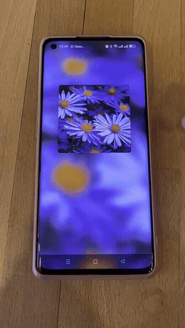
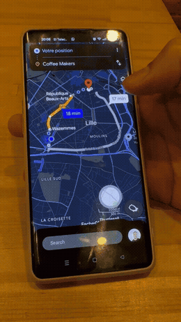

<h1 align="center">Android AGSL Shader Playground 🎨</h1>

<p align="center">
  A Jetpack Compose playground of <b>AGSL runtime-shader animations</b> —<br/>
  tap ripples, flowing waves, ripple reveal transitions, and drag-driven motion blur —<br/>
  each one a drop-in wrapper around any composable.
</p>

<p align="center">
  <a href="https://central.sonatype.com/artifact/io.github.mejdi14/android-shader-effect">
    
  </a>
  
  
  <a href="LICENSE">
    
  </a>
  <a href="https://github.com/mejdi14/Android-AGSL-Shader-Playground/stargazers">
    
  </a>
</p>

## ✨ Demo

<div align="center">
  
  &nbsp;&nbsp;
  
  &nbsp;&nbsp;
  
</div>

## 📑 Table of Contents

- [Features](#-features)
- [Requirements](#️-requirements)
- [Installation](#-installation)
- [Usage](#-usage)
  - [Ripple Effect (tap-reactive)](#ripple-effect-tap-reactive)
  - [Complex Wave Effect (continuous)](#complex-wave-effect-continuous)
  - [Reveal Animation (content transition)](#reveal-animation-content-transition)
  - [Motion Blur Effect (drag-driven)](#motion-blur-effect-drag-driven)
  - [Kaleidoscope (continuous)](#kaleidoscope-continuous)
  - [Vortex Spiral (tap to re-center)](#vortex-spiral-tap-to-re-center)
  - [Holographic Sticker (tilt)](#holographic-sticker-tilt)
  - [Metaballs (generative)](#metaballs-generative)
  - [Liquid Glass (live backdrop)](#liquid-glass-live-backdrop)
  - [Liquid Glass Ring (tap)](#liquid-glass-ring-tap)
  - [Ripple Transition (tap)](#ripple-transition-tap)
- [Advanced Customization](#️-advanced-customization)
- [API Reference](#-api-reference)
- [Contributing](#-contributing)
- [License](#-license)

## 🚀 Features

- ✅ Tap-reactive ripple effects with configurable amplitude, frequency, decay & speed
- ✅ Continuous wave animations with customizable parameters
- ✅ Content reveal transitions driven by a rippling shader mask
- ✅ Drag-driven directional motion blur
- ✅ Kaleidoscope — mirrored, slowly rotating mandala
- ✅ Vortex spiral — twisting distortion you can re-center with a tap
- ✅ Holographic sticker — Pokémon-card foil that sweeps as you tilt the phone
- ✅ Metaballs — gooey coloured balls drifting and merging
- ✅ Liquid glass — a blurred body with sharp edge refraction and chromatic dispersion
- ✅ Liquid glass ring — tap to send a ring of liquid glass across the content
- ✅ Ripple transition — a noisy ripple wavefront crossfades between photos on tap
- ✅ Works with **any** Jetpack Compose content — wrap it and go
- ✅ Every effect accepts your own custom AGSL shader code

## ⚙️ Requirements

| Requirement | Minimum |
|-------------|---------|
| Android SDK | **33+** (Android 13 “Tiramisu”) — AGSL runtime shaders are an Android 13 API |
| Jetpack Compose | 1.7.0+ |
| Language | Kotlin |

## 📦 Installation

Make sure `mavenCentral()` is in your repositories (Gradle’s default in `settings.gradle.kts`):

```kotlin
dependencyResolutionManagement {
    repositories {
        google()
        mavenCentral()
    }
}
```

Then add the dependency to your module’s `build.gradle.kts`:

```kotlin
dependencies {
    implementation("io.github.mejdi14:android-shader-effect:0.1.3")
}
```

## 🔥 Usage

### Ripple Effect (tap-reactive)

Wrap any content; a ripple radiates from wherever the user taps.

```kotlin
ShaderRippleEffect(
    amplitude = 15f,           // height of the ripple waves
    frequency = 20f,           // how many waves appear
    decay = 6f,                // how quickly the ripple fades
    speed = 2000f,             // how fast the ripple propagates
    animationDuration = 3.5f   // duration in seconds
) {
    Image(
        painter = painterResource(id = R.drawable.your_image),
        contentDescription = null,
        modifier = Modifier.fillMaxSize()
    )
}
```

### Complex Wave Effect (continuous)

A continuous, flowing wave distortion — great for water, flags, or living backgrounds.

```kotlin
ComplexWaveEffect(
    speed = 0.8f,          // how fast the waves move
    strength = 25f,        // wave amplitude
    frequency = 8f,        // how many waves appear
    timeMultiplier = 1.2f  // how time scales the animation
) {
    Text(
        text = "Wavy Text Effect",
        style = MaterialTheme.typography.displayLarge,
        modifier = Modifier.padding(32.dp)
    )
}
```

### Reveal Animation (content transition)

Tap to transition from one composable to another behind an expanding, wiggling ripple front.

<div align="center">
  
</div>

```kotlin
RevealShaderEffect(
    waveParams = WaveEffectParams(
        amplitude = 40f,
        frequency = 20f,
        decay = 5f,
        speed = 1000f,
        duration = 3f
    ),
    revealParams = RevealTransitionParams(
        speed = 1200f,
        frequency = 40f,
        wiggleStrength = 38f,
        edgeWidth = 0f,
        duration = 3f,
        transitionDelay = 200
    ),
    firstContent = { FirstContent() },   // content to hide
    secondContent = { SecondContent() }  // content to reveal
)
```

### Motion Blur Effect (drag-driven)

Directional blur that trails the user’s drag and eases out on release. Inspired by [Daniel Kuntz](https://x.com/dankuntz)’ work.

<div align="center">
  
</div>

```kotlin
MotionBlurEffect(
    modifier = Modifier,
    intensity = 2f,        // strength of the blur
    falloffRadius = 390f   // distance over which the blur decays
) {
    YourContent()
}
```

### Kaleidoscope (continuous)

Mirrors your content into radial wedges that form a slowly rotating mandala.

```kotlin
KaleidoscopeEffect(
    segments = 6f,        // number of mirrored wedges
    rotationSpeed = 0.3f  // radians per second
) {
    YourContent()
}
```

### Vortex Spiral (tap to re-center)

A twisting spiral, strongest at the center and fading out by `radius`. Tap to move the center.

```kotlin
VortexEffect(
    strength = 3.5f,  // max twist (radians) at the center
    radius = 700f,    // falloff radius in pixels
    speed = 0.5f      // how fast the spiral churns
) {
    YourContent()
}
```

### Holographic Sticker (tilt)

A glossy foil card that catches the light as you tilt it. Rather than tinting the
artwork, it keeps the card's own colours and lights it: a broad diagonal sheen
sweeps across, and the foil's diamond texture and glitter only appear *inside*
that sweep — the way a real foil card only shows its texture where light hits.
Motion follows Benjamin Pisano's SwiftUI [Sticker](https://github.com/bpisano/Sticker).

```kotlin
HolographicStickerEffect(
    modifier = Modifier.width(240.dp).aspectRatio(580f / 810f),
    motion = StickerMotion.Tilt,   // or Drag
    sheenWidth = 0.26f,            // how broad the light sweep is
    sheenIntensity = 0.45f,        // how bright it is
    foilTexture = 0.2f,            // diamond texture inside the sweep
    sparkle = 0.3f                 // glitter inside the sweep
) {
    Image(
        painter = painterResource(id = R.drawable.your_card),
        contentDescription = null,
        modifier = Modifier.fillMaxSize()
    )
}
```

### Metaballs (generative)

Coloured gooey balls drifting around the centre and merging into smooth organic
shapes. An AGSL port of the `Metaballs` shader from
[@paper-design/shaders](https://shaders.paper.design/metaballs). Unlike the other
effects this one is *generative* — it paints its own image rather than filtering
content — so it draws through a `ShaderBrush` and makes a good animated background.

```kotlin
MetaballsEffect(
    modifier = Modifier.fillMaxSize(),
    count = 10f,        // 1..20 balls; fractions shrink the last one
    size = 0.83f,       // ball size, 0..1
    speed = 1f,         // animation speed
    colors = DefaultMetaballColors
)
```

### Liquid Glass (live backdrop)

`DraggableLiquidGlassDemo` records the scene into one reusable GPU layer, then draws a draggable
rounded rectangle with a saturated 3px blur, a translucent tint, edge-only refraction with
chromatic separation, and a separate specular lighting pass.

```kotlin
DraggableLiquidGlassDemo(background = painterResource(R.drawable.your_photo))
```

### Liquid Glass Ring (tap)

Tap and a ring of liquid glass expands out from the centre across the content at a
steady speed. The ring is the refraction from `LiquidGlass` — same bevel falloff
and colour split, at the same strength — and nothing else: no rim light, shadow,
tint or ripple. The distortion fades to zero at every edge of the ring, so it has
no visible border; you only see it by what it bends.

```kotlin
LiquidGlassRingEffect(
    modifier = Modifier.fillMaxSize(),
    bandWidth = 180.dp,     // thickness of the glass ring
    refraction = 1f,        // 1 = exactly LiquidGlass's strength
    fromTapPoint = false    // true = start where you tap
) {
    YourPhoto()
}
```

### Ripple Transition (tap)

Tap and a noisy ripple wavefront races out from the touch point, pushing the
image, splitting its colour at the crest and revealing the next photo in its
wake. An AGSL port of Mick Cesanek's WebGL [Ripple Transition](https://github.com/m1ckc3s/ripple).
Because it samples two photos at once, they're bound as two child shaders on the
`RuntimeShader`.

```kotlin
RippleTransitionEffect(
    images = listOf(
        ImageBitmap.imageResource(R.drawable.photo_a),
        ImageBitmap.imageResource(R.drawable.photo_b)
    ),
    modifier = Modifier.fillMaxSize(),
    waveSpeed = 1.6f,
    pushAmt = 0.145f,
    glow = 0.73f
)
```

## 🎛️ Advanced Customization

Every effect accepts your own AGSL shader source, so you can override the built-in look entirely:

```kotlin
ShaderRippleEffect(
    rippleShaderCode = """
        uniform shader inputShader;
        uniform float2 uOrigin;
        uniform float uTime;
        // ...your custom AGSL here...
        half4 main(float2 fragCoord) {
            return inputShader.eval(fragCoord);
        }
    """.trimIndent(),
    // other parameters...
) {
    // Your content
}
```

## 👨‍💻 API Reference

### `ShaderRippleEffect`

| Parameter | Type | Default | Description |
|-----------|------|---------|-------------|
| modifier | Modifier | Modifier | Compose modifier |
| amplitude | Float | 12f | Height of the ripple waves |
| frequency | Float | 15f | How many ripple waves appear |
| decay | Float | 8f | How quickly the ripple fades out |
| speed | Float | 1800f | How fast the ripple propagates |
| animationDuration | Float | 3f | Duration of the ripple animation (seconds) |
| rippleShaderCode | String? | null | Custom AGSL shader code |

### `ComplexWaveEffect`

| Parameter | Type | Default | Description |
|-----------|------|---------|-------------|
| modifier | Modifier | Modifier | Compose modifier |
| speed | Float | 0.5f | How fast the waves move |
| strength | Float | 18f | Amplitude of the waves |
| frequency | Float | 10f | How many waves appear |
| timeMultiplier | Float | 1f | How time affects the animation |
| waveShaderCode | String? | null | Custom AGSL shader code |

### `RevealShaderEffect`

| Parameter | Type | Default | Description |
|-----------|------|---------|-------------|
| waveParams | WaveEffectParams | default | Configuration for the expanding wave |
| revealParams | RevealTransitionParams | default | Configuration for the reveal transition |
| modifier | Modifier | Modifier | Compose modifier |
| firstContent | @Composable | required | The initial content to replace |
| secondContent | @Composable | required | The content to reveal |

#### `WaveEffectParams`

| Parameter | Type | Default | Description |
|-----------|------|---------|-------------|
| amplitude | Float | 40f | Wave height |
| frequency | Float | 20f | Ripple density |
| decay | Float | 5f | Ripple fade-out speed |
| speed | Float | 1000f | Propagation speed |
| duration | Float | 3f | Animation duration (seconds) |

#### `RevealTransitionParams`

| Parameter | Type | Default | Description |
|-----------|------|---------|-------------|
| speed | Float | 1200f | Reveal animation speed |
| frequency | Float | 40f | Edge wave frequency |
| amplitude | Float | 30.5f | Edge wave height |
| edgeWidth | Float | 0f | Transition edge width |
| wiggleStrength | Float | 38.0f | Edge distortion intensity |
| duration | Float | 3f | Animation duration (seconds) |
| transitionDelay | Long | 200 | Delay before the transition starts (ms) |

### `MotionBlurEffect`

| Parameter | Type | Default | Description |
|-----------|------|---------|-------------|
| modifier | Modifier | Modifier | Compose modifier |
| intensity | Float | 2f | Strength of the blur effect |
| falloffRadius | Float | 390f | Distance over which the blur decays |

### `DraggableLiquidGlassDemo`

| Parameter | Type | Default | Description |
|-----------|------|---------|-------------|
| modifier | Modifier | Modifier | Full-scene Compose modifier |
| background | Painter | required | Photo recorded into the shared GPU layer |

### `KaleidoscopeEffect`

| Parameter | Type | Default | Description |
|-----------|------|---------|-------------|
| modifier | Modifier | Modifier | Compose modifier |
| segments | Float | 6f | Number of mirrored wedges |
| rotationSpeed | Float | 0.3f | Rotation speed (radians/sec) |
| kaleidoscopeShaderCode | String? | null | Custom AGSL shader code |

### `VortexEffect`

| Parameter | Type | Default | Description |
|-----------|------|---------|-------------|
| modifier | Modifier | Modifier | Compose modifier |
| strength | Float | 3.5f | Max twist (radians) at the center |
| radius | Float | 700f | Falloff radius in pixels |
| speed | Float | 0.5f | How fast the spiral churns |
| vortexShaderCode | String? | null | Custom AGSL shader code |

### `HolographicStickerEffect`

| Parameter | Type | Default | Description |
|-----------|------|---------|-------------|
| modifier | Modifier | Modifier | Compose modifier |
| sheenWidth | Float | 0.28f | How broad the light sweep is |
| sheenIntensity | Float | 0.3f | Brightness of the sweep |
| foilTexture | Float | 0.12f | Diamond texture strength inside the sweep |
| sparkle | Float | 0.18f | Glitter strength inside the sweep |
| checkerScale | Float | 26f | How fine the diamond texture is |
| noiseScale | Float | 220f | How fine the glitter grain is |
| glareIntensity | Float | 0.12f | Soft highlight following the tilt point |
| glareRadius | Float | 0.5f | Size of that highlight |
| pattern | StickerPattern | Diamond | Texture shape (`Diamond` or `Square`) |
| motion | StickerMotion | Tilt | What drives the shine (`Tilt` or `Drag`) |
| tiltIntensity | Float | 1f | Multiplier on the raw device tilt |
| tiltRangeDegrees | Float | 16f | Tilt at which the sweep crosses the card |
| maxTiltDegrees | Float | 10f | How far the card leans at full tilt |
| reverseMotion | Boolean | false | Flips the light *and* the lean together |
| foilShaderCode | String? | null | Custom AGSL shader code |

### `MetaballsEffect`

| Parameter | Type | Default | Description |
|-----------|------|---------|-------------|
| modifier | Modifier | Modifier | Compose modifier |
| colors | List&lt;Color&gt; | 5 defaults | Ball colours, applied in order and cycled (up to 5) |
| colorBack | Color | Black | Background behind the balls |
| count | Float | 10f | How many balls, 1..20 (fractions shrink the last) |
| size | Float | 0.83f | Ball size, 0..1 |
| speed | Float | 1f | Animation speed |
| scale | Float | 1f | Zoom level |
| edgeSoftness | Float | 0.02f | Width of the anti-aliased rim |
| metaballsShaderCode | String? | null | Custom AGSL shader code |

### `LiquidGlassRingEffect`

| Parameter | Type | Default | Description |
|-----------|------|---------|-------------|
| modifier | Modifier | Modifier | Compose modifier |
| durationMillis | Int | 1600 | How long the ring takes to cross |
| bandWidth | Dp | 180.dp | Full thickness of the glass ring |
| refraction | Float | 1f | Strength relative to `LiquidGlass`; 1 matches it exactly |
| dispersion | Float | 0.3f | Colour split, as in `LiquidGlass` |
| fromTapPoint | Boolean | false | Start the ring where you tap instead of the centre |
| ringShaderCode | String? | null | Custom AGSL shader code |
| content | @Composable | required | The content the ring passes over |

### `RippleTransitionEffect`

| Parameter | Type | Default | Description |
|-----------|------|---------|-------------|
| images | List&lt;ImageBitmap&gt; | required | Two or more photos to cycle through |
| modifier | Modifier | Modifier | Compose modifier |
| waveSpeed | Float | 1.6f | How fast the wavefront travels |
| sigma | Float | 0.15f | Thickness of the ripple band |
| waveFreq | Float | 5f | How many ripples ride the band |
| pushAmt | Float | 0.145f | How far the ripple shoves the image |
| caStrength | Float | 0.02f | Colour-channel split at the crest |
| glow | Float | 0.73f | How much the crest brightens |
| noiseWarp | Float | 1f | How much noise distorts the wavefront |
| durationMillis | Int | 1400 | Length of one transition |
| easing | Easing | FastOutSlowInEasing | Easing of the wavefront |
| rippleShaderCode | String? | null | Custom AGSL shader code |

## 🤝 Contributing

Contributions, issues, and feature requests are welcome! Feel free to check the [issues page](https://github.com/mejdi14/Android-AGSL-Shader-Playground/issues).

1. Fork the repo
2. Create your feature branch (`git checkout -b feature/amazing-effect`)
3. Commit your changes
4. Open a Pull Request

## 🙏 Acknowledgements

- The Motion Blur effect is inspired by [Daniel Kuntz](https://x.com/dankuntz)’ work.
- The Ripple Transition effect is an AGSL port of the MIT-licensed [Ripple Transition](https://github.com/m1ckc3s/ripple) by Mick Cesanek.
- The Particles demo is a Compose port of the MIT-licensed Particles block by [Lorenzo Cabra](https://bencho.dev/?c=particles).
- The Metaballs effect is an AGSL port of [@paper-design/shaders](https://github.com/paper-design/shaders).
- The Holographic Sticker effect is an AGSL port of [bpisano/Sticker](https://github.com/bpisano/Sticker) (MIT).
- The Kaleidoscope and Vortex effects are AGSL reinterpretations of ideas from [krispuckett/SwiftUIShaders](https://github.com/krispuckett/SwiftUIShaders) (a Metal shader library for SwiftUI).

## 📝 License

Copyright © 2025 [Mejdi Hafiene](https://x.com/mejdi141).<br />
This project is [MIT](LICENSE) licensed.
